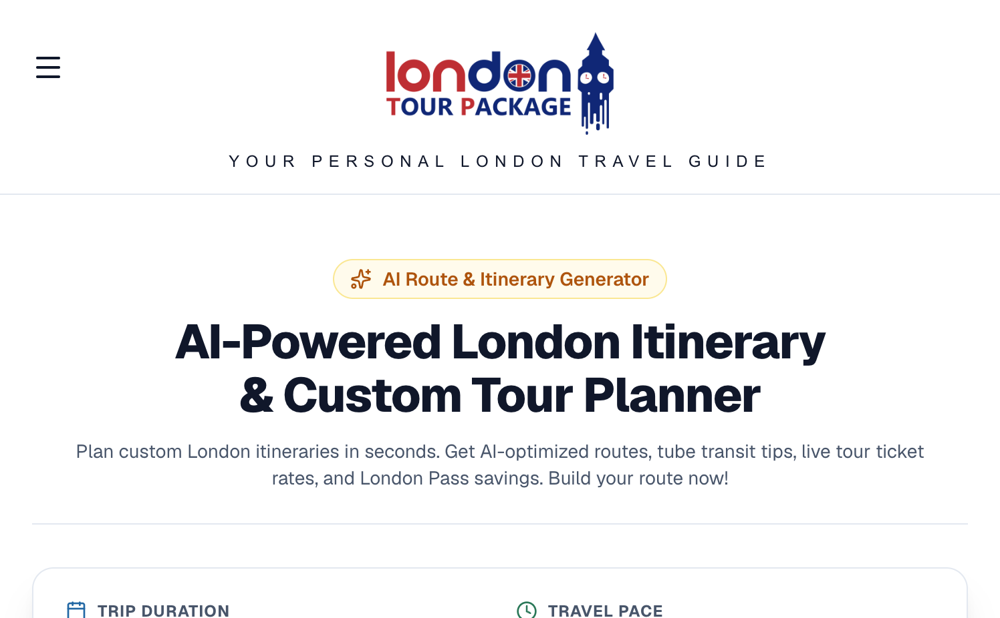

# London AI Route Generator

AI itinerary planner for [London Tour Package](https://londontourpackage.com). Visitors pick trip length, pace, who they are travelling with and what they want to see. The app streams a day-by-day London route with tube tips, live tour tickets and London Pass savings.

**Live:** [londontourpackage.com/planner](https://londontourpackage.com/planner)



## Features

- **Real-time itinerary generation** — each day is planned in parallel and streams in as soon as it is ready
- **Tube routing logic** — geographically clustered days with Underground, bus and river-bus tips between stops
- **Tour ticket integration** — live bookable tours, prices and availability from the Viator Partner API
- **London Pass savings** — walk-up prices compared with Go City passes, with a calculated saving
- **Fast repeat searches** — common itineraries are cached so they load instantly
- **Matches the main site** — header, footer, logo and analytics aligned with londontourpackage.com

## Tech stack

| Layer | Tools |
| --- | --- |
| App | [Next.js](https://nextjs.org) 16 (App Router), React 19, TypeScript |
| AI | [Vercel AI SDK](https://ai-sdk.dev) + OpenAI (`gpt-4o`) |
| UI | Tailwind CSS 4, lucide-react |
| Data | Viator Partner API, Upstash Redis (cache + rate limiting) |
| Hosting | Vercel, served at `/planner` through Cloudflare |

## Getting started

Requires Node.js 20 or later.

```bash
npm install
cp .env.example .env.local   # then add your keys
npm run dev
```

Open [http://localhost:3001/planner](http://localhost:3001/planner) (the app uses a `/planner` base path).

### Environment variables

Copy `.env.example` to `.env.local`. Real keys live only in `.env.local` (git-ignored) and in Vercel / Cloudflare project settings — never in source.

| Variable | Required | Purpose |
| --- | --- | --- |
| `OPENAI_API_KEY` | Yes | Itinerary generation |
| `VIATOR_API_KEY` | For live tours | Viator Partner API. Without it, tour lookups are skipped |
| `VIATOR_API_BASE_URL` | No | Defaults to `https://api.viator.com` |
| `UPSTASH_REDIS_REST_URL`, `UPSTASH_REDIS_REST_TOKEN` | In production | Cache and rate limiting (`KV_REST_API_*` names also work) |
| `NEXT_PUBLIC_GOCITY_AFFILIATE_LINK` | No | Overrides the default Go City affiliate link |
| `PLANNER_PROXY_SECRET` | In production | Shared secret with the Cloudflare Worker. Leave unset locally |

Scripts: `npm run dev`, `npm run build`, `npm run start`, `npm run lint`, `npm run pregenerate`.

## How it is deployed

```
Visitor → Cloudflare (londontourpackage.com)
            ├── /planner*  → Worker → Vercel app
            └── everything else → WordPress
```

- `basePath: "/planner"` in `next.config.ts`. The Vercel root (`/`) redirects to `/planner`.
- A Cloudflare Worker (`cloudflare/worker.js` is a reference copy) forwards `/planner` to Vercel and attaches a shared-secret header so the generate/tours APIs cannot be called on `*.vercel.app` directly.
- That worker is edited in the Cloudflare dashboard, not deployed from this repo.

## Project structure

```
src/app/            Pages, layout and API routes (/api/generate, /api/tours)
src/components/     Header, footer, tour cards, progress UI
src/lib/            AI schema, cache, rate limit, Viator client, pass savings
scripts/            Cache warm-up (pregenerate.mjs)
cloudflare/         Reference copy of the Cloudflare Worker
```

## Known limitations / next steps

- Tour lookup is skipped if the Viator key is missing; the itinerary still renders without live prices.
- Pass savings are an estimate from published gate prices and live Viator entry rates, not a booking quote.
- Very unusual trip combinations are generated live; popular ones are served from cache. That keeps cost down, but first-time odd queries are slower.
- There is no save/share or account. Closing the tab loses the plan.
- Affiliate click-through is not yet attributed back to a specific itinerary.

Next: persist and share plans, track which itineraries convert on Viator and Go City, and surface live TfL disruption on the transit tips.

## Affiliate disclosure

London Tour Package participates in affiliate programmes including Viator and Go City (via Travelpayouts). Some booking links in this app are affiliate links. If you buy through them, the site may earn a commission at no extra cost to you.
